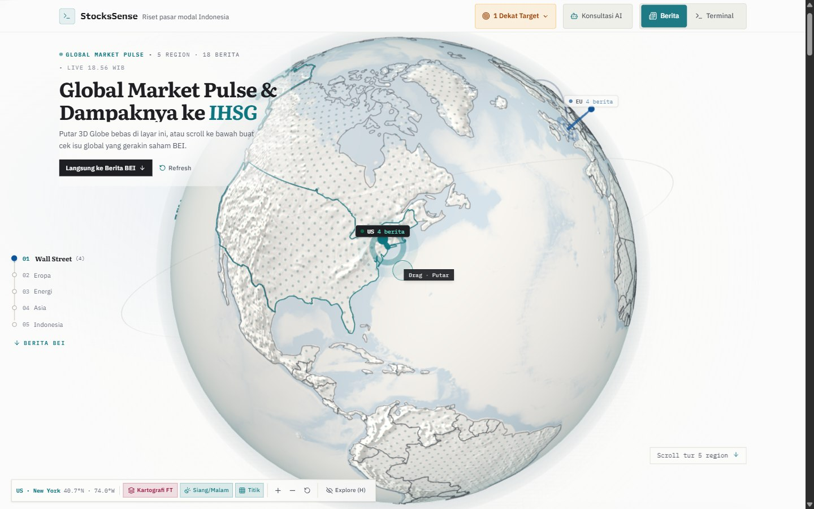
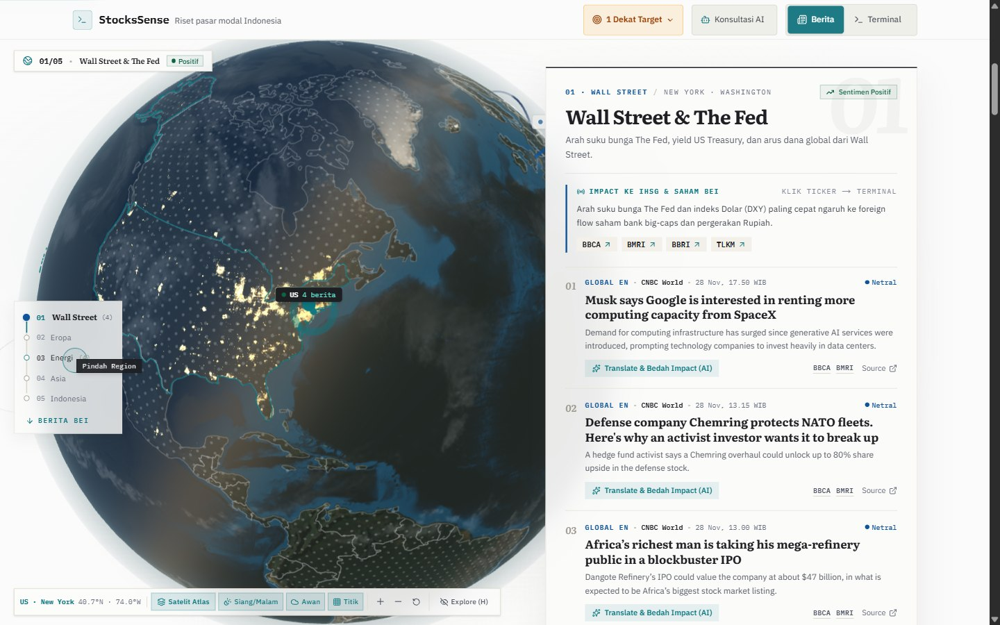
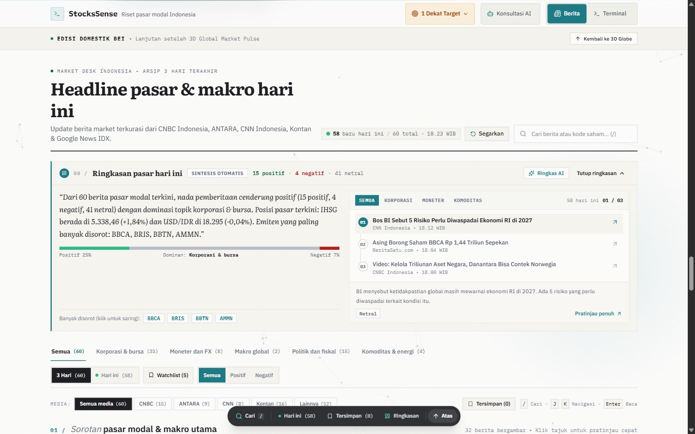
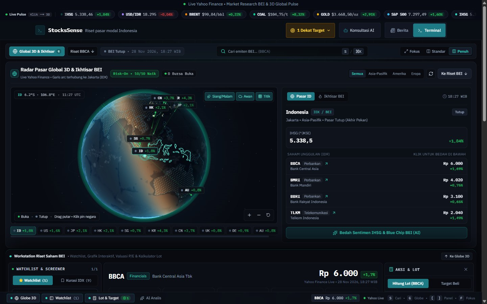

# 📈 StocksSense — Indonesian Stock & Global Macro Intelligence Terminal

> 🌐 [English](README.md) | **Bahasa Indonesia**

[](https://nextjs.org/)
[](https://react.dev/)
[](https://www.typescriptlang.org/)
[](https://tailwindcss.com/)
[](https://threejs.org/)
[](https://vitest.dev/)
[](https://opensource.org/licenses/MIT)

**StocksSense** adalah platform riset saham Indonesia (BEI/IHSG) dan intelijen makro global berbasis web yang memadukan **pengalaman 3D Global News Scrollytelling full-bleed bergaya Financial Times**, **berita pasar modal BEI real-time**, **peta bola dunia 3D interaktif**, **analitik teknikal-fundamental berdensitas tinggi**, serta **asisten riset Gemini AI** dalam satu aplikasi **Dual-Mode** yang terisolasi bersih:

1. **Mode Berita (FT Editorial Full-Bleed 3D Scrollytelling + Broadsheet — Warm Ivory `#FBFBFA`):** Langsung dibuka oleh Bumi 3D penuh layar bebas halangan (dengan toggle shader live **Satelit Atlas ↔ Kartografi FT**), scrollytelling off-center optik `camera.setViewOffset()` lintas 5 kawasan global, **Orbital Velocity Market Ticker** yang sinkron ke Globe, **Editorial Ink-Trail Cursor**, serta Broadsheet berita BEI domestik + **AI Market Brief**.
2. **Mode Terminal (Unified Obsidian Workstation — Matte Dark `#080A0F`):** Ruang kerja top-down Matte Obsidian + StocksSense Teal yang menyatukan **Hybrid Dark Orbital 3D Earth (NASA Blue/Black Marble + UTC Day/Night Terminator)**, **Ikhtisar Pasar BEI**, **Pro Trading Side Docks** (Snowflake Score, Teknikal, Pivot Points, ARA/ARB, Risk/Reward & Paper Trading), dan **Workstation Riset Saham BEI**.

---

## 🖼️ Cuplikan Antarmuka

| FT Editorial 3D Hero — Mode Kartografi FT | Style A Off-Center Scrollytelling — Satelit Atlas |
| :---: | :---: |
|  |  |

| Broadsheet Domestik BEI & AI Market Brief | Unified Dark Obsidian Terminal & 3D Globe |
| :---: | :---: |
|  |  |

---

## 🌟 Fitur Utama

### 1. 🗞️ Mode Berita: FT Editorial Full-Bleed 3D Scrollytelling & Broadsheet
* **Full-Bleed Interactive 3D Global News Globe (Opsi 2C Dual-Style Shader):**
  * Crossfade GLSL mulus secara real-time antara **Satelit Atlas** (tekstur siang NASA Blue Marble, awan lembut, terminator UTC, bayangan halus di kertas, cincin meridian arsitektur) dan **Kartografi FT** (lautan biru pucat porselen, daratan putih tulang stippling, garis negara tinta charcoal, highlight FT Teal).
  * **Style A Optical Off-Center Scrollytelling (`camera.setViewOffset()`):** Dibuka di tengah layar 100% bebas halangan (`pointer-events` pass-through sehingga Bumi bisa langsung di-drag dari ruang kosong mana saja), lalu bergeser optik ke sisi kiri tanpa distorsi perspektif saat 5 bab berita global (`01 Wall Street & The Fed` → `02 Eropa & Geopolitik` → `03 Timur Tengah & Energi` → `04 Asia & Komoditas` → `05 Domestik & IHSG`) meluncur rapi di sisi kanan.
  * **1A Vertical Timeline Rail + 2A Unified Bottom-Left Dock + Mode Explore (`H`):** Rel timeline vertikal *frosted glass* di tepi kiri, bilah kontrol terpadu kiri-bawah berbasis portal (`Atlas/Kartografi`, `Siang/Malam`, `Awan`, `Titik`, `Zoom`, `Explore H`) yang 100% anti-ketutup kartu, serta tombol **Explore (`H`)** untuk menyembunyikan seluruh kartu & teks.
* **Pipeline RSS Global & Indonesia (`/api/news/global` + `/api/news`):**
  * Mengagregasi berita finansial global live (CNBC World/Finance, BBC Business, Google News Global Markets) yang di-geo-tag ke 6 hotspot 3D (`US`, `EU`, `ME`, `CN`, `JP`, `ID`), lengkap dengan *pull-quote* **Impact ke IHSG & Saham BEI** dan tombol 1-klik **"Translate & Bedah Impact (AI)"**.
  * Cache RSS server dengan deduplikasi request dan hard timeout 5 detik (mencakup `fetch` + pembacaan body) agar feed lambat tidak pernah menggantung halaman.
* **Orbital Velocity `MarketTicker` & Interactive `EditorialCursorField`:**
  * Pita ticker reaktif kecepatan scroll (`IHSG`, `USD/IDR`, `BRENT`, `COAL`, `GOLD`, `S&P 500`) dengan pause saat hover dan klik simbol untuk langsung memutar 3D Globe ke kawasan terkait.
  * Sistem kursor editorial khusus desktop dengan **Calligraphic Ink Trail** tipis saat roaming (FT Teal / FT Claret, auto-idle 0% CPU saat kursor diam), *roaming ink ring*, *contextual micro-pill* (`Drag · Putar`, `Bedah AI`, `Buka Terminal`, `Pratinjau`), dan *click ink-ripple*.
* **Broadsheet Domestik BEI (`#editorial-paper-section`):**
  * Transisi mulus sesama kertas hangat `#FBFBFA` menuju agregasi berita BEI 3 hari (CNBC Indonesia, ANTARA, CNN Indonesia, Kontan, Google News IDX), **AI Market Brief**, filter media/sentimen/Watchlist, bookmark tersimpan, `NewsReaderDrawer` berbasis portal (`z-[70]`), serta auto-pause GPU WebGL (`IntersectionObserver`).

### 2. 🌍 Unified Terminal: Hybrid Dark Orbital 3D Globe + Pro Trading Suite
* **Hybrid Dark Orbital Earth (Three.js + Tekstur NASA):**
  * Memantau **10 pusat pasar global** (`ID`, `US`, `JP`, `HK`, `SG`, `KR`, `CN`, `UK`, `DE`, `AU`) beserta **40 saham blue-chip live** dengan normalisasi mata uang lokal (`IDR`, `USD`, `JPY`, `HKD`, `SGD`, `KRW`, `CNY`, `GBP`, `EUR`, `AUD`).
  * Menggabungkan tekstur lokal NASA Blue Marble + lampu kota Black Marble + relief topografi + awan bergerak, terminator Siang/Malam UTC real-time dengan pita senja dua nada, ~5.400 Fibonacci instanced micro-dots, busur komet 3D animasi ke Jakarta (`IDX`), market spikes 3D, dan radar ripples.
* **Pro Trading Side Docks (`LeftIntelligenceDock` & `RightTradingDeskDock`):**
  * **Left Intelligence Dock:** **StockSense Snowflake Score** 5 sumbu (`Value`, `Future`, `Past`, `Health`, `Dividend`), **Technical Summary Meter** (RSI-14, MACD, MA20/50), **Pivot Points** (`S3`–`R3`), dan **Kalkulator ARA / ARB BEI** dengan fraksi harga otomatis.
  * **Right Trading Desk Dock:** **Risk/Reward & Position Sizer** (`1R`/`2R`/`3R`) dan **Simulasi Paper Trading BEI** persisten (`Rp 100 Jt` modal virtual + P&L real-time).
  * **Terminal Cursor Field:** Reticle & ambient spotlight mode gelap yang terisolasi khusus di Mode Terminal.
* **Workstation Riset Saham BEI:**
  * **5-Pillar Stock Health Ribbon**, **TradingView Lightweight Charts v5** (`Lilin`/`Garis`, `MA20`, `MA50`, `RSI`, `Volume`, penanda dividen, garis Harga Wajar & Target Beli), **Interactive P/E Valuation Gauge Arc (`-2 SD`..`+2 SD`) & Nilai Intrinsik Graham**, **Simulasi DCA & Lump-Sum** (split-adjusted + DRIP vs IHSG), **Multi-Saham Compare**, **Alokasi Modal Watchlist**, dan Watchlist persisten hingga 15 emiten dengan ekspor/impor JSON.

### 3. ⌨️ Navigasi & Pintasan Keyboard
* **Mode Berita:** `H` (Toggle Explore Mode 3D Globe), `/` (Cari berita domestik), `J`/`K` (Navigasi baris kawat pasar), `Enter` (Buka Reader Drawer), `←`/`→`/`Esc` (Navigasi/tutup drawer).
* **Mode Terminal:** `S` atau `⌘K`/`Ctrl+K` (Command Search emiten), `G` (Lipat/buka Radar Global 3D), `[` (Toggle Watchlist), `]` (Toggle Right Rail), `F` (Preset Fokus Chart).

### 4. 🤖 Asisten Konsultasi Gemini AI
* Side panel konsultasi kontekstual (`POST /api/ai/analyze`) yang otomatis membaca saham aktif, metrik valuasi, Watchlist, berita global & domestik, alokasi portofolio, hingga dampak transmisi kawasan 3D Globe ke IHSG.
* Mendukung kunci API server (`GEMINI_API_KEY`) maupun kunci pribadi (BYOK) di browser.

---

## 🛠️ Tech Stack & Arsitektur

* **Framework:** [Next.js 16](https://nextjs.org/) (App Router, Cache Components `"use cache"`, Webpack production build)
* **Runtime & Language:** [React 19](https://react.dev/), [TypeScript 5](https://www.typescriptlang.org/)
* **Styling & Motion:** [Tailwind CSS v4](https://tailwindcss.com/), [Framer Motion](https://www.framer.com/motion/), [Lucide Icons](https://lucide.dev/)
* **Visualisasi 3D & Grafik:** [Three.js](https://threejs.org/) (`world-atlas` + `topojson-client` + tekstur NASA lokal), [TradingView Lightweight Charts v5](https://tradingview.github.io/lightweight-charts/)
* **Data Pasar & Berita:** [yahoo-finance2](https://github.com/gadicc/node-yahoo-finance2) + Agregasi RSS Global & BEI + Google Gemini API
* **Pengujian:** [Vitest](https://vitest.dev/) (**100** unit tests pada **23** file uji)
* **Tipografi & Lokalisasi:** *Literata*, *IBM Plex Sans*, *IBM Plex Mono* (`tabular-nums`), format angka standar Indonesia (`id-ID`) melalui [src/lib/format.ts](src/lib/format.ts).

```text
stocksense/
├── docs/screenshots/                       # Screenshot showcase untuk README
├── public/textures/                        # Tekstur Bumi NASA lokal (day, night, topology, clouds)
├── src/
│   ├── app/
│   │   ├── api/
│   │   │   ├── ai/analyze/route.ts         # Konsultasi Gemini AI kontekstual
│   │   │   ├── global-markets/route.ts     # Snapshot 10 bursa global + 40 blue chips
│   │   │   ├── history/[ticker]/route.ts   # Riwayat OHLCV & dividen (Yahoo / ilustrasi)
│   │   │   ├── macro/route.ts              # Indikator makro (IHSG, USD/IDR, S&P500, Gold, Brent, Coal)
│   │   │   ├── news/route.ts               # Agregasi RSS pasar modal Indonesia 3 hari
│   │   │   ├── news/global/route.ts        # Agregasi RSS finansial global (5 kawasan / 6 pin 3D)
│   │   │   ├── news/brief/route.ts         # Ringkasan AI Market Brief
│   │   │   ├── quotes/route.ts             # Batch live quotes emiten BEI
│   │   │   └── stocks/                     # Profil fundamental & pencarian emiten BEI
│   │   ├── page.tsx                        # Orkestrator Dual-Mode (FT Editorial Berita & Dark Terminal)
│   │   └── terminal/page.tsx               # Permalink redirect ke Mode Terminal
│   ├── components/
│   │   ├── ai/GeminiAiModal.tsx            # Side panel asisten analisis Gemini AI
│   │   ├── layout/                         # Navbar & Orbital Velocity MarketTicker
│   │   ├── news/
│   │   │   ├── NewsWorldScrollytelling.tsx # Style A Full-Bleed 3D Scrollytelling + 1A Rail + Kartu FT
│   │   │   ├── EditorialCursorField.tsx    # Calligraphic ink trail, roaming ring & click ripple
│   │   │   ├── NewsView.tsx                # Broadsheet Domestik BEI, filter & kawat pasar
│   │   │   ├── NewsReaderDrawer.tsx        # Drawer pratinjau cepat berbasis portal
│   │   │   └── ...                         # MarketBriefPanel, NewsFloatingDock, NewsAmbientBackground
│   │   └── terminal/
│   │       ├── WorldGlobe3D.tsx            # Dual-Theme Three.js Globe (Dark Orbital / Atlas / Kartografi FT)
│   │       ├── UnifiedGlobalCommandDeck.tsx# Command Deck 3D + Ikhtisar BEI + Scroll Parallax
│   │       ├── LeftIntelligenceDock.tsx    # Snowflake Score, Teknikal, Pivot Points, ARA/ARB
│   │       ├── RightTradingDeskDock.tsx    # Risk/Reward Sizer & Simulasi Paper Trading
│   │       └── ...                         # TerminalMainPane, Watchlist, Chart, Valuasi, DCA, Compare
│   ├── hooks/                              # useMarketData, useGlobalMarkets, useGlobalNews, useLiveNews, useAiChat
│   ├── data/                               # Dataset kurasi BEI & makro fallback
│   └── lib/                                # Cache Yahoo/RSS, global news, globe math, trading tools & __tests__/ (23 file)
└── package.json
```

---

## 🚀 Cara Menjalankan Secara Lokal

Pastikan Anda telah memasang [Node.js](https://nodejs.org/) **v22+** (atau v20+).

1. **Clone repository & instal dependensi:**
   ```bash
   git clone https://github.com/christianlandrawicaksono-collab/stocksense.git
   cd stocksense
   npm install
   ```

2. **Konfigurasi Environment Variables (opsional, buat file `.env.local`):**
   ```env
   # Gunakan "yahoo" untuk data pasar live & RSS berita, atau "illustrative" untuk mode data ilustrasi lokal
   MARKET_DATA_PROVIDER=yahoo

   # Opsional: kunci Google Gemini API untuk fitur AI Analis & AI Market Brief
   GEMINI_API_KEY=your_gemini_api_key_here
   GEMINI_MODEL=gemini-3-flash-preview
   ```
   > Tanpa `.env.local`, aplikasi tetap berjalan mulus dalam mode `illustrative` menggunakan dataset acuan bawaan, dan pengguna tetap bisa memasukkan kunci Gemini pribadi langsung dari panel AI.

3. **Jalankan development server:**
   ```bash
   npm run dev
   ```
   Buka `http://localhost:3000` (Mode Berita 3D Editorial FT) atau `http://localhost:3000/?mode=terminal` (Unified Terminal 3D).

4. **Verifikasi Test, Lint, dan Production Build:**
   ```bash
   npm test
   npx eslint src
   npm run build
   ```

---

## ⚖️ Integritas Data & Disclaimer

1. **Sumber Data Transparan:** Saat `MARKET_DATA_PROVIDER=yahoo` aktif, harga saham BEI, indeks global, dan saham unggulan negara lain bersumber dari **Yahoo Finance** (~10–15 menit tertunda sesuai bursa) dengan cache server terkelola, serta berita global & domestik dari umpan **RSS pasar modal publik**. Bila penyedia eksternal tidak tersedia atau mode `illustrative` dipakai, aplikasi secara eksplisit menampilkan label **Ilustrasi / Data Acuan**.
2. **Bukan Rekomendasi Finansial:** Seluruh visualisasi, metrik valuasi, simulasi DCA/lot/paper-trading, serta analisis AI pada platform ini ditujukan untuk **riset dan edukasi pasar modal**, bukan anjuran transaksi beli/jual saham atau nasihat keuangan berlisensi.

---

## 📄 Lisensi

Proyek ini dilisensikan di bawah [MIT License](LICENSE).
