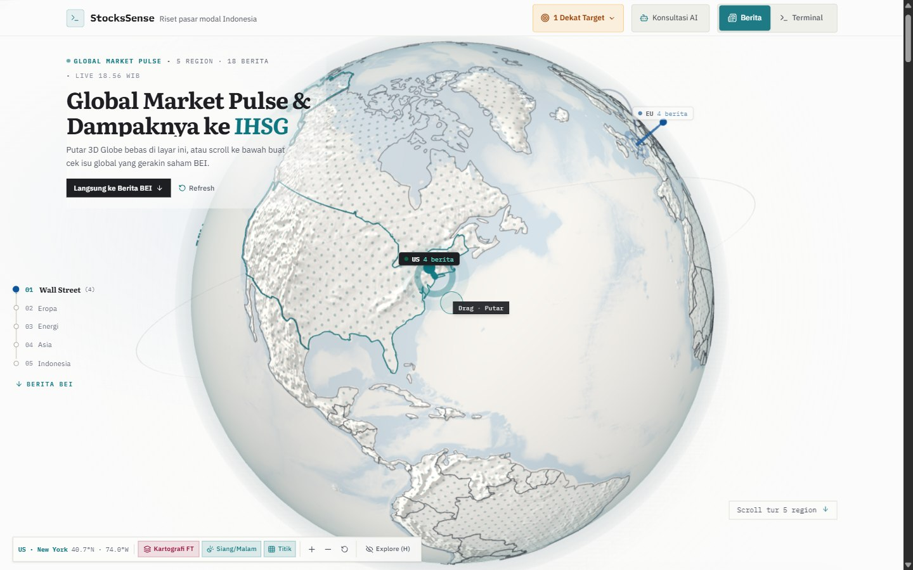
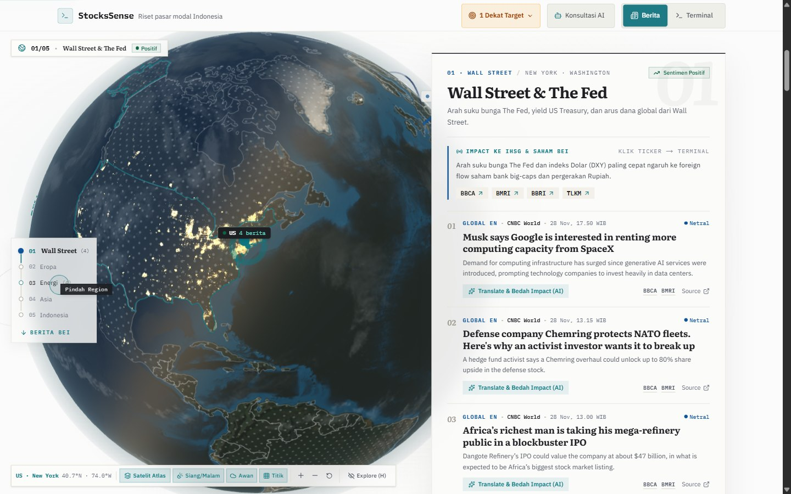
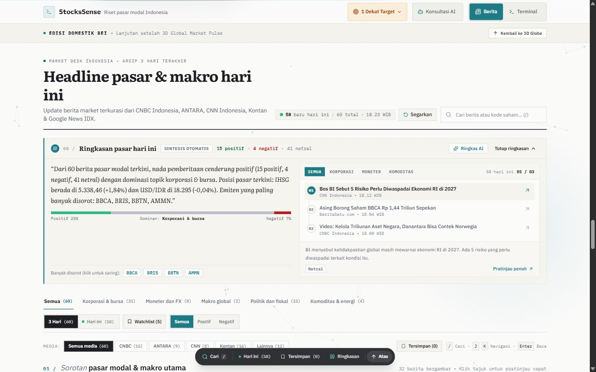
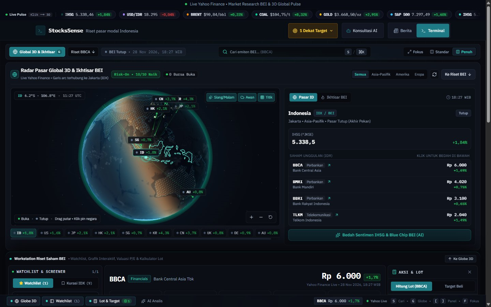

# 📈 StocksSense — Indonesian Stock & Global Macro Intelligence Terminal

> 🌐 **English** | [Bahasa Indonesia](README.id.md)

[](https://nextjs.org/)
[](https://react.dev/)
[](https://www.typescriptlang.org/)
[](https://tailwindcss.com/)
[](https://threejs.org/)
[](https://vitest.dev/)
[](https://opensource.org/licenses/MIT)

**StocksSense** is an Indonesian stock market (IDX / IHSG) and global macro intelligence web platform that combines a **Financial Times-inspired full-bleed 3D global news scrollytelling experience**, **real-time IDX capital market news**, an **interactive Hybrid Dark Orbital 3D global markets globe**, **high-density technical & fundamental analytics**, and a **contextual Gemini AI analyst** inside a cleanly isolated **Dual-Mode** architecture:

1. **News Mode (FT Editorial Full-Bleed 3D Scrollytelling + Broadsheet — Warm Ivory `#FBFBFA`):** Opens directly onto an unobstructed full-bleed 3D Earth (`Satelit Atlas ↔ Kartografi FT` live GLSL crossfade) with optical off-center `camera.setViewOffset()` scrollytelling across 5 macro regions, an Orbital Velocity market ticker synced to the globe, a calligraphic ink-trail cursor, and a seamless Indonesian IDX broadsheet with **AI Market Brief**.
2. **Terminal Mode (Unified Obsidian Workstation — Matte Dark `#080A0F`):** A top-down Matte Obsidian + StocksSense Teal command center unifying a **Hybrid Dark Orbital 3D Globe (NASA Blue/Black Marble + UTC Day/Night Terminator)**, **IDX Market Overview**, **Pro Side Docks** (Snowflake Score, Technicals, Pivot Points, ARA/ARB, Risk/Reward & Paper Trading), and **IDX Stock Research Workstation**.

---

## 🖼️ Interface Showcase

| FT Editorial 3D Hero — Kartografi FT Mode | Style A Off-Center Scrollytelling — Satelit Atlas |
| :---: | :---: |
|  |  |

| Domestic IDX Broadsheet & AI Market Brief | Unified Dark Obsidian Terminal & 3D Globe |
| :---: | :---: |
|  |  |

---

## 🌟 Key Features

### 1. 🗞️ News Mode: FT Editorial Full-Bleed 3D Scrollytelling & Broadsheet
* **Full-Bleed Interactive 3D Global News Globe (Opsi 2C Dual-Style Shader):**
  * Live GLSL crossfade between **Satelit Atlas** (NASA Blue Marble daylight atlas, soft clouds, UTC terminator, paper contact shadow, architectural meridian ring) and **Kartografi FT** (porcelain oceans, bone-ivory stippled continents, charcoal ink borders, FT Teal country highlight).
  * **Style A Optical Off-Center Scrollytelling (`camera.setViewOffset()`):** Opens centered and 100% unobstructed (`pointer-events` pass-through so you can drag/spin anywhere), then optically glides the globe to the left without perspective distortion as 5 regional news chapters (`01 Wall Street & The Fed` → `02 Eropa & Geopolitik` → `03 Timur Tengah & Energi` → `04 Asia & Komoditas` → `05 Domestik & IHSG`) scroll cleanly down the right.
  * **1A Vertical Timeline Rail + 2A Unified Bottom-Left Dock + Explore Mode (`H`):** Frosted vertical timeline progress rail on the left margin, a portaled bottom-left instrument dock (`Atlas/Kartografi`, `Siang/Malam`, `Awan`, `Titik`, `Zoom`, `Explore H`) with zero card overlap, and 1-click **Explore Mode (`H`)** to hide all overlays.
* **Hybrid Global & Indonesian RSS Pipeline (`/api/news/global` + `/api/news`):**
  * Aggregates live global financial wires (CNBC World/Finance, BBC Business, Google News Global Markets) geo-tagged to 6 globe hotspots (`US`, `EU`, `ME`, `CN`, `JP`, `ID`) with **Impact to IHSG & IDX Tickers** pull-quotes and 1-click **"Translate & Bedah Impact (AI)"**.
  * Hardened server-side RSS cache with request deduplication and strict 5-second timeout protection so slow feeds never block rendering.
* **Orbital Velocity `MarketTicker` & Interactive `EditorialCursorField`:**
  * Velocity-reactive marquee ribbon (`IHSG`, `USD/IDR`, `BRENT`, `COAL`, `GOLD`, `S&P 500`) with hover-to-pause and click-to-focus 3D Globe region synchronization.
  * Desktop editorial cursor system with tapered **Calligraphic Ink Trail** (FT Teal / FT Claret, auto-idle 0% CPU), roaming ink ring, contextual micro-pills (`Drag · Putar`, `Bedah AI`, `Buka Terminal`, `Pratinjau`), and click ink-ripples.
* **Domestic IDX Broadsheet (`#editorial-paper-section`):**
  * Seamless warm-ivory transition into 3-day multi-source Indonesian capital market news (CNBC Indonesia, ANTARA, CNN Indonesia, Kontan, Google News IDX), **AI Market Brief**, publisher/sentiment/watchlist filters, persistent bookmarks, portaled `NewsReaderDrawer` (`z-[70]`), and automatic WebGL GPU pause (`IntersectionObserver`).

### 2. 🌍 Unified Terminal: Hybrid Dark Orbital 3D Globe + Pro Trading Suite
* **Hybrid Dark Orbital Earth (Three.js + NASA Textures):**
  * Tracks **10 global financial hubs** (`ID`, `US`, `JP`, `HK`, `SG`, `KR`, `CN`, `UK`, `DE`, `AU`) and **40 live blue-chip equities** with local-currency formatting (`IDR`, `USD`, `JPY`, `HKD`, `SGD`, `KRW`, `CNY`, `GBP`, `EUR`, `AUD` — including `GBp → GBP` normalization).
  * Combines local NASA Blue Marble + Black Marble city lights + topographic relief + drifting clouds, real-time UTC Day/Night terminator with dual-tone twilight, ~5,400 Fibonacci instanced micro-dots, animated 3D comet-trail arcs into Jakarta (`IDX`), vertical market spikes, and radar ripples.
* **Pro Trading Side Docks (`LeftIntelligenceDock` & `RightTradingDeskDock`):**
  * **Left Intelligence Dock:** 5-axis **StockSense Snowflake Score** (`Value`, `Future`, `Past`, `Health`, `Dividend`), **Technical Summary Meter** (RSI-14, MACD, MA20/50), **Pivot Points** (`S3`–`R3`), and **IDX ARA / ARB Calculator** with tick-size snapping.
  * **Right Trading Desk Dock:** **Risk/Reward & Position Sizer** (`1R`/`2R`/`3R`) and persistent local **Paper Trading IDX Simulator** (`Rp 100M` virtual portfolio with real-time P&L).
  * **Terminal Cursor Field:** Subtle dark-mode reticle & ambient spotlight strictly isolated to Terminal Mode.
* **Core IDX Research Workstation:**
  * **5-Pillar Stock Health Ribbon**, **TradingView Lightweight Charts v5** (`Candlestick`/`Line`, `MA20`, `MA50`, `RSI`, `Volume`, dividend markers, Fair Value & Target Buy lines), **Interactive P/E Valuation Gauge Arc (`-2 SD`..`+2 SD`) & Graham Intrinsic Value**, **DCA & Lump-Sum Backtest Simulator** (split-adjusted + DRIP vs IHSG), **Multi-Stock Comparison**, **Watchlist Allocation**, and persistent 15-stock Watchlist with JSON export/import.

### 3. ⌨️ Navigation & Keyboard Shortcuts
* **News Mode:** `H` (Toggle 3D Globe Explore Mode), `/` (Search domestic news), `J`/`K` (Navigate wire rows), `Enter` (Open Reader Drawer), `←`/`→`/`Esc` (Navigate/close drawer).
* **Terminal Mode:** `S` or `⌘K`/`Ctrl+K` (Command Search), `G` (Toggle 3D Global Deck), `[` (Toggle Watchlist), `]` (Toggle Right Rail), `F` (Focus Chart preset).

### 4. 🤖 Integrated Gemini AI Analyst
* Contextual research drawer (`POST /api/ai/analyze`) automatically aware of active stock fundamentals, valuation bands, Watchlist targets, global & domestic news catalysts, portfolio allocation, and 3D Globe regional transmissions.
* Supports both server-configured keys (`GEMINI_API_KEY`) and client-side Bring-Your-Own-Key (BYOK).

---

## 🛠️ Tech Stack & Architecture

* **Framework:** [Next.js 16](https://nextjs.org/) (App Router, `"use cache"` Cache Components, Webpack production build)
* **Runtime & Language:** [React 19](https://react.dev/), [TypeScript 5](https://www.typescriptlang.org/)
* **Styling & Motion:** [Tailwind CSS v4](https://tailwindcss.com/), [Framer Motion](https://www.framer.com/motion/), [Lucide Icons](https://lucide.dev/)
* **3D & Financial Charts:** [Three.js](https://threejs.org/) (`world-atlas` + `topojson-client` + NASA local textures), [TradingView Lightweight Charts v5](https://tradingview.github.io/lightweight-charts/)
* **Market Data & AI:** [yahoo-finance2](https://github.com/gadicc/node-yahoo-finance2), Multi-source Global & IDX RSS aggregators, Google Gemini API
* **Testing:** [Vitest](https://vitest.dev/) (**100** unit tests across **23** test files)
* **Typography & Localization:** *Literata*, *IBM Plex Sans*, *IBM Plex Mono* (`tabular-nums`), centralized Indonesian number formatting (`id-ID`) in [src/lib/format.ts](src/lib/format.ts).

```text
stocksense/
├── docs/screenshots/                       # README showcase captures
├── public/textures/                        # Local NASA Earth textures (day, night, topology, clouds)
├── src/
│   ├── app/
│   │   ├── api/
│   │   │   ├── ai/analyze/route.ts         # Contextual Gemini AI analyst endpoint
│   │   │   ├── global-markets/route.ts     # 10 global exchanges + 40 blue chips snapshot
│   │   │   ├── history/[ticker]/route.ts   # OHLCV & dividend history (Yahoo / illustrative)
│   │   │   ├── macro/route.ts              # Macro tickers (IHSG, USD/IDR, S&P500, Gold, Brent, Coal)
│   │   │   ├── news/route.ts               # 3-day Indonesian capital market RSS pipeline
│   │   │   ├── news/global/route.ts        # Global financial RSS geo-tagged to 5 regions / 6 pins
│   │   │   ├── news/brief/route.ts         # On-demand AI Market Brief generator
│   │   │   ├── quotes/route.ts             # Batched live IDX equity quotes
│   │   │   └── stocks/                     # IDX company fundamentals & live ticker search
│   │   ├── page.tsx                        # Dual-Mode orchestrator (FT Editorial News & Dark Terminal)
│   │   └── terminal/page.tsx               # Permalink redirect into Terminal Mode
│   ├── components/
│   │   ├── ai/GeminiAiModal.tsx            # Contextual Gemini AI side drawer
│   │   ├── layout/                         # Navbar & Orbital Velocity MarketTicker
│   │   ├── news/
│   │   │   ├── NewsWorldScrollytelling.tsx # Style A Full-Bleed 3D Scrollytelling + 1A Rail + FT Cards
│   │   │   ├── EditorialCursorField.tsx    # Calligraphic ink trail, roaming ring & click ripples
│   │   │   ├── NewsView.tsx                # Domestic IDX Broadsheet, filters & wire feed
│   │   │   ├── NewsReaderDrawer.tsx        # Portaled quick-preview editorial drawer
│   │   │   └── ...                         # MarketBriefPanel, NewsFloatingDock, NewsAmbientBackground
│   │   └── terminal/
│   │       ├── WorldGlobe3D.tsx            # Dual-Theme Three.js Globe (Dark Orbital / Atlas / Kartografi FT)
│   │       ├── UnifiedGlobalCommandDeck.tsx# 3D Command Deck + IDX Overview + Scroll Parallax
│   │       ├── LeftIntelligenceDock.tsx    # Snowflake Score, Technicals, Pivot Points, ARA/ARB
│   │       ├── RightTradingDeskDock.tsx    # Risk/Reward Sizer & Paper Trading Simulator
│   │       └── ...                         # TerminalMainPane, Watchlist, Chart, Valuation, DCA, Compare
│   ├── hooks/                              # useMarketData, useGlobalMarkets, useGlobalNews, useLiveNews, useAiChat
│   ├── data/                               # Curated IDX reference & fallback macro datasets
│   └── lib/                                # Yahoo/RSS cache, global news, globe math, trading tools & __tests__/ (23 files)
└── package.json
```

---

## 🚀 Getting Started Locally

Make sure you have [Node.js](https://nodejs.org/) **v22+** (or v20+) installed.

1. **Clone the repository and install dependencies:**
   ```bash
   git clone https://github.com/christianlandrawicaksono-collab/stocksense.git
   cd stocksense
   npm install
   ```

2. **Configure Environment Variables (optional — create `.env.local`):**
   ```env
   # Use "yahoo" for live market quotes & RSS news, or "illustrative" for offline reference data
   MARKET_DATA_PROVIDER=yahoo

   # Optional: Google Gemini API key for AI Analyst & AI Market Brief
   GEMINI_API_KEY=your_gemini_api_key_here
   GEMINI_MODEL=gemini-3-flash-preview
   ```
   > Without `.env.local`, the app runs cleanly out of the box in `illustrative` mode using built-in reference datasets, and users can still supply a personal Gemini API key directly inside the AI side panel.

3. **Start the development server:**
   ```bash
   npm run dev
   ```
   Open `http://localhost:3000` (FT Editorial 3D News Mode) or `http://localhost:3000/?mode=terminal` (Unified 3D Terminal).

4. **Run Tests, Linting, and Production Build:**
   ```bash
   npm test
   npx eslint src
   npm run build
   ```

---

## ⚖️ Data Integrity & Disclaimer

1. **Transparent Data Sourcing:** When `MARKET_DATA_PROVIDER=yahoo` is enabled, IDX equities, global benchmark indices, and international blue-chip quotes are fetched via **Yahoo Finance** (~10–15 minute delayed depending on exchange) with server-side caching, while global & Indonesian market news is aggregated from public **capital-market RSS feeds**. Whenever an upstream source is unavailable or `illustrative` mode is active, the UI explicitly labels metrics as **Illustrative / Reference Data**.
2. **Not Financial Advice:** All charts, valuation models, DCA/lot/paper-trading simulations, and AI-generated outputs are provided strictly for **research and educational purposes** and do not constitute licensed investment advice or buy/sell recommendations.

---

## 📄 License

This project is licensed under the [MIT License](LICENSE).
